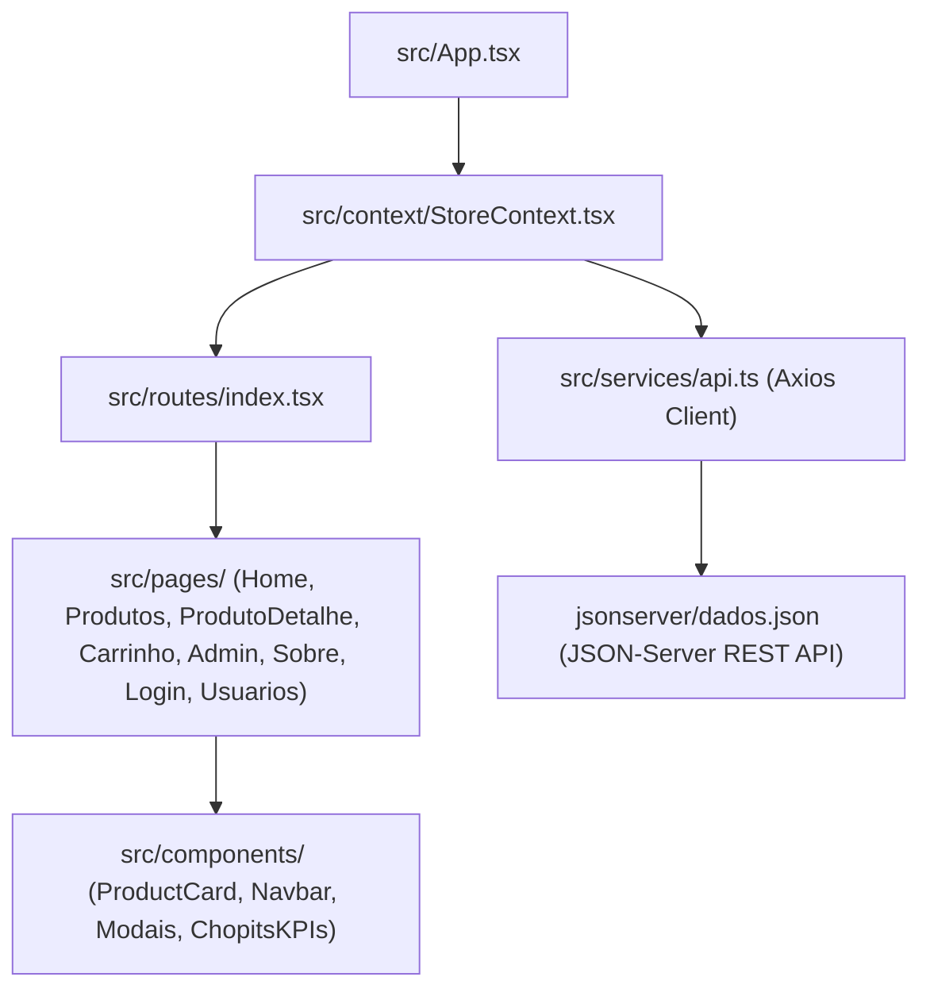

# 🏛️ Arquitetura em Camadas (Chopits)

## Responsabilidades de Cada Camada:
1. **`src/types/`**: Define contratos estritos de dados (`Produto`, `Usuario`, `ItemCarrinho`, `Cupom`, `HomeBannerConfig`).
2. **`src/services/`**: Instância Axios com `baseURL` dinâmica e validação de variáveis de ambiente.
3. **`src/context/`**: Hub reativo com Context API que unifica carrinho, cupons, wishlist e ações do catálogo.
4. **`src/pages/`**: Telas completas roteadas pelo React Router v7.
5. **`src/components/`**: Peças de interface reutilizáveis e componíveis.
