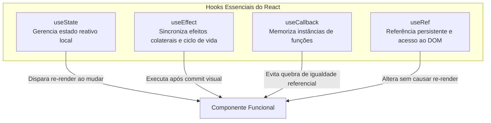

# 🎓 Relatório Técnico & Documentação de Prática Acadêmica

## Projeto Chopits — Desenvolvimento Frontend com React 19 & TypeScript

---

### 📋 Ficha de Identificação Acadêmica

- **Projeto:** Chopits E-Commerce & Sistema Interativo
- **Contexto:** Trabalho Prático do 4º Semestre — Curso Superior de Sistemas para Internet (SI)
- **Desenvolvedor / Aluno:** Daniel Satel Pereira
- **Tecnologias Principais:** React 19, TypeScript, Vite 7, React Router DOM v7, Axios, Bootstrap 5, JSON-Server, Docker & Nginx
- **Repositório:** [github.com/Peridan1/trab-chopits](https://github.com/Peridan1/trab-chopits)
- **Ano Letivo:** 2025

---

## 🎯 1. Apresentação e Objetivo Pedagógico

Este documento consolida a fundamentação teórica, as decisões arquiteturais e a aplicação prática dos conceitos lecionados durante a disciplina de desenvolvimento frontend moderno.

O projeto **Chopits** foi desenvolvido inicialmente para atender aos requisitos de avaliação propostos pelo docente, evoluindo progressivamente de exemplos básicos de controle de fluxo para uma **Single Page Application (SPA)** completa, conteinerizada e pronta para expansão como um marketplace real.

---

## 📚 2. Fundamentação Teórica (Pesquisa Conceitual)

### 2.1 A Evolução do React: De Componentes de Classe para Hooks

Historicamente, o React manipulava estado e ciclo de vida exclusivamente através de **Componentes baseados em Classe** (`class Component extends React.Component`). Esse paradigma impunha barreiras didáticas e operacionais:

- **Complexidade sintática do `this`:** Erros frequentes de escopo e necessidade de _binding_ manual de métodos nos construtores.
- **Dificuldade de reutilização de lógica de estado:** Para compartilhar regras entre componentes, recorria-se a padrões complexos como _Higher-Order Components (HOCs)_ e _Render Props_, gerando o fenômeno conhecido como _Wrapper Hell_.
- **Fragmentação do ciclo de vida:** Lógicas relacionadas (ex: assinar e desinscrever um listener) precisavam ser espalhadas em métodos distintos (`componentDidMount` e `componentWillUnmount`).

Com a introdução dos **React Hooks**, componentes passaram a ser **funções puras** com capacidades estendidas de estado e efeitos colaterais.

---

### 2.2 Análise dos Hooks Fundamentais



#### A. `useState`

- **Definição:** Hook que introduz uma variável reativa de estado e uma função despachante (_setter_) dentro do componente.
- **Mecanismo:** Ao invocar a função atualizadora, o React agenda uma nova renderização do componente caso o valor tenha mudado (checagem por `Object.is`).
- **Princípio da Imutabilidade:** O estado nunca deve ser mutado diretamente (`estado.push()`), mas sim substituído por uma nova referência (`setEstado([...estado, novoItem])`), garantindo que o algoritmo de reconciliação (_Virtual DOM_) detecte a alteração.

#### B. `useEffect`

- **Definição:** Hook responsável por gerenciar **efeitos colaterais** (_side effects_), tais como: requisições HTTP, mutações manuais do DOM, timers e inscrições de eventos.
- **Controle de Execução (Dependency Array):**
  1. `useEffect(() => { ... })`: Executa após **toda** renderização.
  2. `useEffect(() => { ... }, [])`: Executa **apenas uma vez** após a montagem inicial (_mount_).
  3. `useEffect(() => { ... }, [variavel])`: Executa no _mount_ e sempre que `variavel` sofrer mutação referencial.
- **Função de Limpeza (_Cleanup_):** Retornar uma função dentro do `useEffect` permite cancelar inscrições ou listeners antes da desmontagem (_unmount_) do componente, prevenindo vazamentos de memória (_memory leaks_).

#### C. `useCallback`

- **Definição:** Memorizador de funções. Retorna uma versão em cache da função passada que só é recriada caso alguma dependência do array se modifique.
- **Aplicação Prática:** Evita que componentes filhos renderizem desnecessariamente por receberem novas referências de funções em cada ciclo de renderização do componente pai.

#### D. `useRef`

- **Definição:** Cria um contêiner mutável cujo atributo `.current` persiste durante toda a vida útil do componente.
- **Diferença Chave para o `useState`:** Modificar o valor de `.current` **não** dispara uma nova renderização na tela. É ideal para focar inputs, armazenar IDs de `setInterval` e guardar referências físicas a elementos HTML.

---

## 🔍 3. Mapeamento Prático: Onde Cada Conceito Foi Aplicado no Chopits

A tabela a seguir estabelece a **rastreabilidade direta** entre os conceitos ensinados pelo professor e sua implementação real no código-fonte do projeto:

| Conceito / Hook                       | Arquivo no Projeto                                                                                                  | Trecho / Implementação                                       | Finalidade Prática no Chopits                                                   |
| :------------------------------------ | :------------------------------------------------------------------------------------------------------------------ | :----------------------------------------------------------- | :------------------------------------------------------------------------------ |
| **`useState` (Formulários & Modais)** | [Usuarios/index.tsx](file:///home/danielpereira/projetos/pessoal/trab-chopits/src/pages/Usuarios/index.tsx#L9-L14)  | `const [modalAberto, setModalAberto] = useState(false);`     | Controla abertura/fechamento de modais e captura dados de inputs.               |
| **`useState` (Listas Reativas)**      | [Home/index.tsx](file:///home/danielpereira/projetos/pessoal/trab-chopits/src/pages/Home/index.tsx#L5-L6)           | `const [lista, setLista] = useState<string[]>([]);`          | Armazena a lista de lembretes e tarefas interativa.                             |
| **`useEffect` (Consumo REST)**        | [Usuarios/index.tsx](file:///home/danielpereira/projetos/pessoal/trab-chopits/src/pages/Usuarios/index.tsx#L35-L37) | `useEffect(() => { carregarUsuarios(); }, []);`              | Dispara a requisição `GET` ao `json-server` na montagem do componente.          |
| **`useEffect` (Persistência Local)**  | [Home/index.tsx](file:///home/danielpereira/projetos/pessoal/trab-chopits/src/pages/Home/index.tsx#L30-L32)         | `useEffect(() => { localStorage.setItem(...); }, [lista]);`  | Sincroniza tarefas com o `localStorage` sempre que a lista for modificada.      |
| **Roteamento Dinâmico (`useParams`)** | [Produtos/index.tsx](file:///home/danielpereira/projetos/pessoal/trab-chopits/src/pages/Produtos/index.tsx#L7)      | `const { parametro } = useParams<{ parametro?: string }>();` | Captura filtros diretos da URL como `/produtos/eletronicos`.                    |
| **TypeScript (Tipagem Rígida)**       | [types/index.ts](file:///home/danielpereira/projetos/pessoal/trab-chopits/src/types/index.ts)                       | `interface Usuario`, `interface Produto`                     | Garante contratos seguros de dados vindos da API, prevenindo erros de execução. |
| **Axios & API REST Centralizada**     | [api.ts](file:///home/danielpereira/projetos/pessoal/trab-chopits/src/services/api.ts)                              | `export const api = axios.create(...)`                       | Instância HTTP centralizada com baseURL dinâmica e timeout configurado.         |
| **Tratamento Resiliente de Erros**    | [Usuarios/index.tsx](file:///home/danielpereira/projetos/pessoal/trab-chopits/src/pages/Usuarios/index.tsx#L25-L33) | `try { ... } catch (err) { ... }`                            | Feedback amigável ao usuário quando o backend estiver fora do ar.               |

---

## 💻 4. Casos Práticos de Estudo no Código

### Caso 1: Ciclo de Vida e Efeitos Colaterais com `localStorage` (`Home/index.tsx`)

Na página inicial, implementou-se um gerenciador de lembretes que demonstra com clareza o uso de dois `useEffect` com propósitos distintos:

```tsx
// 1. Efeito de Leitura (Mount): Executa UMA ÚNICA VEZ ao carregar a página
useEffect(() => {
  const listaSalva = localStorage.getItem("minhasTarefas");
  if (listaSalva) {
    try {
      setLista(JSON.parse(listaSalva));
    } catch (err) {
      console.error("Erro ao carregar tarefas:", err);
    }
  }
}, []); // Array vazio = mount

// 2. Efeito de Sincronização: Executa SEMPRE que o estado 'lista' mudar
useEffect(() => {
  localStorage.setItem("minhasTarefas", JSON.stringify(lista));
}, [lista]); // Observa mutações na 'lista'
```

> **Explicação Teórica:** Essa separação ilustra o modelo mental moderno do React: efeitos não devem ser amarrados ao ciclo de vida procedural da tela, mas sim agir como sincronizadores declarativos entre o estado da aplicação e mecanismos externos.

---

### Caso 2: CRUD Assíncrono com API REST (`Usuarios/index.tsx`)

O gerenciamento de usuários demonstra a transição de coleções locais em memória para persistência remota via protocolo HTTP:

```tsx
// Operação de Edição vs Criação (PUT / POST)
const salvarUsuario = async (e: React.FormEvent) => {
  e.preventDefault();
  if (!nomeInput.trim() || !emailInput.trim()) return;

  try {
    if (editandoId !== null) {
      // Operação PUT: Atualização de recurso existente
      const usuarioAtualizado = { nome: nomeInput, email: emailInput };
      await api.put(`${ENDPOINTS.USUARIOS}/${editandoId}`, usuarioAtualizado);

      // Imutabilidade: mapeia novo array substituindo apenas o alterado
      setUsuarios((prev) =>
        prev.map((u) =>
          u.id === editandoId ? { ...u, ...usuarioAtualizado } : u,
        ),
      );
    } else {
      // Operação POST: Criação de novo recurso
      const novoUsuario = { nome: nomeInput, email: emailInput };
      const resposta = await api.post<Usuario>(ENDPOINTS.USUARIOS, novoUsuario);

      // Imutabilidade: adiciona o novo item ao final sem mutar o array original
      setUsuarios((prev) => [...prev, resposta.data]);
    }
  } catch (err) {
    console.error("Erro na comunicação com a API:", err);
  }
};
```

---

## 🏛️ 5. Arquitetura de Software e Padrões Aplicados

Para além dos conceitos básicos de React, o projeto adotou boas práticas de engenharia de software ensinadas no 4º semestre:

1. **Separação de Preocupações (_Separation of Concerns_):**
   - `components/`: Elementos visuais reutilizáveis (ex: `Navbar`).
   - `pages/`: Visões completas da aplicação acopladas a rotas específicas.
   - `services/`: Camada de comunicação HTTP externa isolada da interface.
   - `routes/`: Declaração centralizada da árvore de navegação com React Router.
   - `types/`: Contratos e tipagens TypeScript para integridade estrutural.
2. **Defensive Programming & UX Feedback:**
   - Estados explícitos de `loading` (exibição de Spinners durante chamadas lentas).
   - Estados de `erro` com banners de alerta informativos em caso de indisponibilidade da API.
3. **Engenharia de Infraestrutura:**
   - Utilização de **Docker Multi-Stage Build** para empacotar a aplicação de ~1.3 GB em uma imagem ultraleve de ~25 MB com **Nginx** de alta performance.
   - Configuração de proxy reverso e regra `try_files` no Nginx para viabilizar o roteamento SPA sem gerar erro 404.

---

## 🚀 6. Visão de Futuro: A Transição para a "Chopits Store"

O projeto foi intencionalmente arquitetado para permitir que o exercício acadêmico se transforme em um e-commerce comercialmente viável, inspirado nos pilares de sucesso de marketplaces como a **Shopee**, mantendo uma identidade visual e conceitual própria:

```
┌────────────────────────────────────────────────────────────────────────┐
│                        ROADMAP DE TRANSFORMAÇÃO                        │
├────────────────────────────┬───────────────────────────────────────────┤
│ 1. Vitrine & Gamificação   │ Flash Deals (cronômetro regressivo),      │
│                            │ Banners carrossel, Moedas/Pontos Chopits  │
├────────────────────────────┼───────────────────────────────────────────┤
│ 2. Catálogo & Detalhes     │ Galeria com zoom, seletor de variações,   │
│                            │ cálculo de frete simulado e avaliações    │
├────────────────────────────┼───────────────────────────────────────────┤
│ 3. Carrinho & Cupons       │ Seleção de itens por checkbox, cupom de   │
│                            │ frete grátis e cálculo dinâmico de total  │
├────────────────────────────┼───────────────────────────────────────────┤
│ 4. Checkout Simulado       │ Fluxo de pagamento (PIX / Cartão) e tela  │
│                            │ com rastreio de status de pedido          │
└────────────────────────────┴───────────────────────────────────────────┘
```

---

## 🏁 7. Conclusão Acadêmica

O desenvolvimento do **Chopits** consolidou de maneira empírica o aprendizado de desenvolvimento web moderno com **React 19** e **TypeScript**.

A substituição de arrays estáticos por uma API REST estruturada, aliada ao domínio dos Hooks (`useState`, `useEffect`) e à criação de rotas dinâmicas, permitiu compreender na prática como sistemas escaláveis, performáticos e tolerantes a falhas são concebidos e implementados no mercado profissional.

---

_Documento elaborado por Daniel Satel Pereira para fins acadêmicos e comprovação de proficiência prática em Desenvolvimento de Software._
