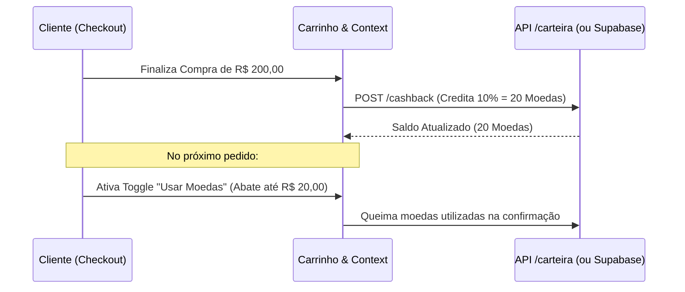

# 🚀 Visão de Evolução & Melhorias Futuras (Roadmap de Portfólio)
## Projeto Chopits — E-Commerce Arquitetado em React 19 + TypeScript

Este documento registra funcionalidades avançadas concebidas para o projeto **Chopits**, projetadas para serem ativadas conforme o sistema amadurecer e expandir sua complexidade além da base acadêmica.

---

## 🪙 1. Sistema de Cashback & Programa de Fidelidade (Moedas Chopits)

### 1.1 Conceito e Justificativa de Negócio
Em grandes marketplaces, o mecanismo de acúmulo de pontos/moedas funciona como um gatilho de **retenção de clientes (LTV - Lifetime Value)**. A cada compra concluída, o usuário recebe um percentual do valor em moedas virtuais para abater no próximo pedido.

### 1.2 Por que foi desacoplado da versão inicial?
Para a versão de apresentação no portfólio acadêmico, optou-se por priorizar:
1. **Clean UI & Clareza Visual:** Uma experiência de checkout direta, profissional e sem poluição de elementos de gamificação prematuros.
2. **Foco nos Fundamentos de Engenharia:** Domínio de CRUD REST (`json-server`), tipagem estática TypeScript, Context API com Hooks (`useState`, `useEffect`, `useCallback`, `useRef`, `useMemo`), e cupons de desconto reais (`CHOPITS10`, `CHOPITS25`, `FRETEGRATIS`).
3. **Simplicidade Inicial antes da Complexidade:** Princípio KISS (*Keep It Simple, Stupid*) antes de escalar para microserviços de carteira digital.

### 1.3 Arquitetura Técnica Proposta para Futura Implementação
Quando for ativado, o módulo de fidelidade operará sob o seguinte contrato:

---

## 🗄️ 2. Transição da Camada de Persistência (JSON-Server -> Banco Real)

* **Fase Atual (Acadêmica):** Persistência via `json-server` (`jsonserver/dados.json`), cumprindo integralmente os requisitos didáticos de consumo HTTP via Axios (`GET`, `POST`, `PUT`, `DELETE`).
* **Próxima Fase:** Migração dos endpoints para **Supabase (PostgreSQL)** ou API REST própria em Node/Express/NestJS, com tabelas relacionais (`products`, `users`, `orders`, `coupons`, `wishlists`).

---

## 💳 3. Gateway de Pagamento Real (Stripe / Mercado Pago / Asaas)
* **Fase Atual:** Simulação interativa com desconto automático de 5% no PIX e parcelamento no cartão.
* **Próxima Fase:** Integração com Webhooks de confirmação de pagamento em tempo real.

---

*Documento mantido para planejamento de portfólio e expansão contínua da engenharia do software Chopits.*
